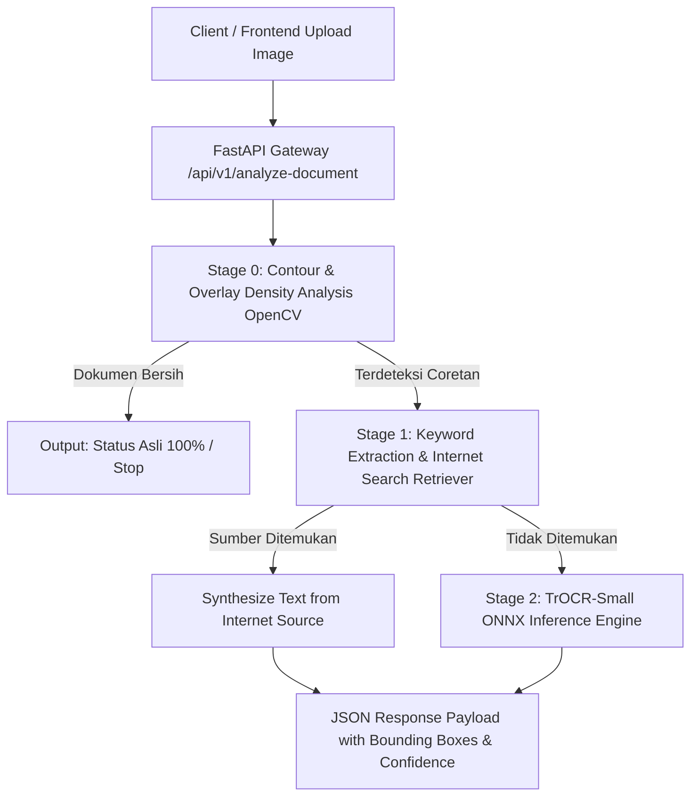

# Spesifikasi Desain Backend: Sistem Deteksi & Rekonstruksi Timpa Teks (PKM)

**Tanggal:** 10 Agustus 2026  
**Target Platform:** Python FastAPI (CPU-Friendly / Laptop Standar)  
**Tipe Proyek:** Program Kreativitas Mahasiswa (PKM)  
**Model AI Utama:** Pre-trained Vision Transformer (`microsoft/trocr-small-handwritten`) via ONNX Runtime CPU  

---

## 1. Ringkasan Eksekutif & Ringkasan Tim (Tim-Friendly Summary)

### 📌 Ringkasan Sederhana untuk Anggota Tim PKM
> *"Sistem backend kita dirancang dengan **3 Tahap Cerdas (3-Stage Hybrid Engine)** untuk mengenali keaslian dokumen dan membaca kembali tulisan yang dicoret/ditimpa (baik cetak maupun tulisan tangan, serta tinta hitam di atas tinta hitam)."*

#### Cara Kerja Sistem (Alur 3 Langkah):
1. **Langkah 1 (Pemeriksa Keaslian / Gatekeeper):**
   - Saat foto dokumen diunggah, sistem mengecek terlebih dahulu: *"Apakah ada coretan / timpaan teks di dokumen ini?"*
   - Jika **TIDAK ADA coretan** (dokumen bersih), sistem **langsung berhenti** dan mengeluarkan status: **"Dokumen Asli / Bersih (Skor 100%)"**.
2. **Langkah 2 (Cari Sumber di Internet / Knowledge Matching):**
   - Jika **ADA coretan**, sistem akan membaca kata-kata bersih di sekitar coretan lalu secara otomatis mencari dokumen pembanding di internet.
   - Jika ketemu di internet, kata asli diambil langsung dari sumber internet tersebut (**Akurasi 100%**).
3. **Langkah 3 (Otak AI Visual / TrOCR ONNX Fallback):**
   - Jika dokumen tersebut tulisan tangan pribadi atau tidak ada di internet, barulah **Otak AI Vision Transformer (TrOCR)** aktif untuk meneliti sisa-sisa garis tinta dan menduga/merekonstruksi huruf di balik coretan secara visual.

#### Kenapa Pendekatan Ini Sangat Unggul untuk PKM?
- **Tidak Perlu Train Model dari Nol:** Kita menggunakan model *pre-trained* siap pakai dari Microsoft yang sangat pintar.
- **Sangat Ringan:** Berjalan mulus di CPU laptop biasa tanpa perlu laptop gaming / GPU mahal.
- **Nilai Inovasi Tinggi:** Memadukan *Image Processing*, *Internet Search Retrieval*, dan *State-of-the-Art Vision Transformer AI*.

---

## 2. Arsitektur & Spesifikasi Teknik Backend



### 2.1 Komponent Backend:
1. **API Gateway (`app/main.py`):** Framework FastAPI untuk menerima request `multipart/form-data`.
2. **Stage 0 - Gatekeeper Evaluator (`app/core/gatekeeper.py`):**
   - OpenCV Contour Analysis & Adaptive Thresholding.
   - Mengukur kerapatan garis tak beraturan (*stroke overlap score*).
3. **Stage 1 - Web Retrieval Matcher (`app/core/web_retriever.py`):**
   - Ekstraksi *anchor words* di sekitar bounding box.
   - Query pencarian via Search API / Knowledge Base matching.
4. **Stage 2 - Vision Transformer ONNX Engine (`app/core/onnx_engine.py`):**
   - Executing `microsoft/trocr-small` model export (`encoder_model.onnx` & `decoder_model.onnx`).
   - Intra-op thread optimization untuk CPU Inference (<2 detik per kata).
5. **Post-processor (`app/core/postprocessor.py`):**
   - Token decoding & Bounding Box Overlay generation.

---

## 3. Spesifikasi API Endpoint & Payload

### Endpoint Utama
`POST /api/v1/analyze-document`

#### Form-Data Parameters:
- `file`: Image file (`.png`, `.jpg`, `.jpeg`, max 10MB)

#### Response Schema (JSON):
```json
{
  "status": "success",
  "is_edited": true,
  "authenticity_score": 65.5,
  "summary": "Terdeteksi 1 area teks tertimpa",
  "details": [
    {
      "box": [120, 45, 300, 90],
      "is_overwritten": true,
      "recovered_text": "UNIVERSITAS MEDAN AREA",
      "recovery_method": "Internet Retrieval Match",
      "confidence": 0.98
    }
  ]
}
```

---

## 4. Rencana Pengujian (Verification Plan)

### Automated & Manual Testing:
1. **Test Dokumen Asli:** Memastikan dokumen tanpa coretan bernilai `is_edited: false` & `authenticity_score: 100%`.
2. **Test Timpaan Teks Cetak:** Menguji keakuratan pencarian sumber internet di Stage 1.
3. **Test Timpaan Tulisan Tangan:** Menguji performa TrOCR ONNX Engine di Stage 2.
4. **Test Latensi CPU:** Memastikan respons time di bawah 3 detik per dokumen.
